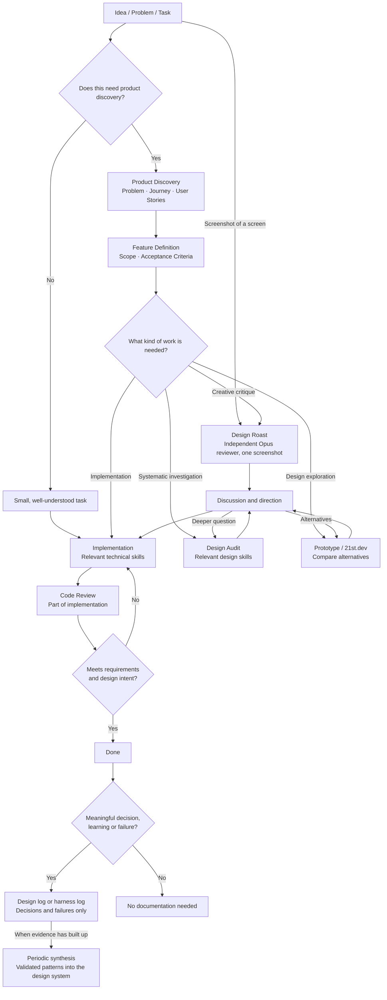

# latam-trip

Simon's planner for a two-month solo trip through Central America, Colombia and Bolivia (December 2026 to February 2027). Supabase holds shared trip and research data. The repo holds the Claude plugin, worker and two React apps. "Simon" in this file and the skills means Simon or the agent coordinating the work.

## One checkout, one branch

- There is exactly one working copy of this repo on this machine: `C:\Users\Simon\Documents\github\latam-trip`. Never create a git worktree or a second clone. If you need to set work aside, such as edits left by stopped agents, commit them with explicit paths on `wip/YYYY-MM-DD-<topic>`, push it and switch back to a clean `main`. Never leave unfinished edits in `main`.
- `main` is the only long-lived branch and the one you work on. Commit in small steps and push to `origin/main` without asking.
- Short-lived branches are fine for a feature or an experiment, but they are merged into `main` and deleted as soon as the work is in. Before deleting a branch, confirm `git log main..<branch>` is empty.
- No git identity is configured on this machine. Commit with `git -c user.name=Claude -c user.email=noreply@anthropic.com`, matching the existing history.

## Workflow

Not every task goes through every box. Most work is the short path: understand it, implement it, review the code, ship. The three reviews are different questions:

| Review | Question | Lives in |
|---|---|---|
| Design Roast | What is fundamentally wrong with this screen | `design-roaster` on Opus, an outside creative director given the screenshot and the screen's purpose, nothing else |
| Design Audit | Why is it wrong, and what should change systematically | `senior-designer` on Opus through `ui-roast`, the detailed review format, written to `docs/design/reviews/` |
| Code Review | Is the implementation correct and maintainable | Implementation, on the diff, with `/code-review` or `feature-dev:code-reviewer` |

A design issue is not automatically a code finding and a code finding is not a design issue. Each review reports in its own place.

### Product work

`feature-spec` decides how much specification a change needs. Lightweight work gets a few lines and goes to implementation. A comprehensive feature gets a `FEAT` spec in `docs/product/features/`, discovery with `superpowers:brainstorming`, a plan with `superpowers:writing-plans`, and a separate review only when it touches owner only data, the bucket, the schema or a product decision. Every spec opens with the journey, and the work is judged against that journey.

### Design work

- **Roast** is the first line of review for UI work. A built or changed screen is roasted before Simon looks at it, and any ongoing task can be picked up with a shot. "Roast this screenshot: <path>" goes to `design-roaster`, with the screen name and one line on what the screen is for. No prep agent, no brief, no mandatory Playwright run, no design decisions or earlier reviews handed over. The roast comes back short, opinionated and scored, it is discussed, and only what Simon accepts is recorded. `ui-roast` says how.
- **Audit** when a roast or a discussion leaves a cross screen, structural or design system question. `senior-designer` runs it: scoped, multi screen, evidence based, built on the principles and decisions, with `apple-design`, `impeccable` and `emil-design-eng` loaded when they help. Writes a review file.
- **Explore** when the direction is unclear or there are real alternatives. `prototype` builds several distinct versions behind a switcher in the actual stack, 21st.dev gives components and inspiration. No Figma dependency. Compare, pick, then implement the winner. Not for minor changes.
- **Implement** with the frontend skills below.
- **Evaluate** the built thing against the journey, starting with a roast of the built screen.
- **Consolidate** validated patterns into `design-principles.md`, the tokens in `planner/src/styles` and the shared components, through a retrospective when the evidence has built up, not on a schedule.

### Agents and models

Do the work yourself when that is simplest. Dispatch an agent when the work needs independent judgement (a roast), runs in parallel on disjoint files, needs a specialist perspective, or is too large for one context. Hand agents file paths, ask for a few lines back, and name the model on every dispatch.

- Haiku for mechanical work: copying, sweeps, transcription.
- Sonnet for ordinary implementation and recording.
- Opus for complex reasoning, design judgement, high impact decisions, and complex frontend work such as motion, animation and component design.

Agents in `plugin/agents/`: `design-roaster` (Opus, the roast, knows the product but not the design record), `senior-designer` (Opus, audits and retrospectives, knows the whole record), `doc-keeper` (Sonnet, doc audit on demand). A new or changed agent file loads only when a session starts. Until then, dispatch `general-purpose` with the model named and tell it to read `plugin/agents/<name>.md` first. Related small tasks go to one implementer, each task its own commit. Disjoint work runs in parallel in this one checkout, each agent staging only its own paths and never stashing, resetting or checking out over another agent's work. Decide an ambiguity, write it down and keep going. Ask Simon only before something irreversible he has not already approved.

### Code review

Every implementation that is more than a trivial fix gets a review of the diff: architecture and separation of concerns, component structure and reuse, state and data flow, API and backend correctness, responsive implementation, accessibility, performance, error handling and edge cases, type safety, tests and coverage, maintainability, regressions. `/code-review` or `feature-dev:code-reviewer` does it, with the project's technical skills, without duplicating them. One reviewer walks a batch commit by commit. The main session checks a fix round against the diff itself. Fixes touching owner only data, the private bucket or what goes into built files get a second look.

### Records

- Decisions carry ids that never change: PROD in `docs/product/`, DES in `docs/design/`, TECH in `docs/technical/`.
- `docs/harness-log.md` holds meaningful decisions outside those logs and meaningful harness failures: wrong agent behaviour, poor reviews, missed requirements, redundant handovers, skill conflicts, excessive context use, recurring failure modes. Each entry has the decision or failure, the reasoning or cause, the corrective action and the outcome. Not every minor interaction.
- `docs/README.md` maps every doc with its owner and triggers. Read the docs that cover a task before it, update them in the same commit, never show planned work as built.

## Privacy

The repo and the `web` bucket are public. Booking references, prices paid, names and attachments live only in owner only tables and a private bucket, never in a built file, a commit, a doc or a test fixture. Fixtures use `TEST01`.

- `.env` holds the Supabase keys. Never print or commit it.
- Design shots go in `docs/design/shots/`, which is git ignored because the shots show private trip data. The reviews and the design and product logs describe what a shot shows, never what a ticket says.
- No AWS account id or profile name in any file.
- Leave the untracked `Microsoft/`, `_to_delete/` and `.playwright-mcp/` alone, and stage explicit paths only.

## Supabase data

Supabase is the shared source of truth. Use `tripdb query TABLE` to read rows, `tripdb doc-get NAME` to read documents, `tripdb file NAME` to read built files, and `tripdb status` to inspect worker state. `data/README.md` describes the tables and commands. Never create or commit a local copy of live rows or documents.

## tripdb

`plugin/scripts/tripdb.py` is the supported way to write data: `python -I -X utf8 plugin/scripts/tripdb.py --root . <command>`, and `--help` lists the commands. It checks every row against its table's schema and refuses bad rows with the reason. Run its tests after changing it:

    python -I -X utf8 -m unittest discover -s plugin/scripts -p "test_*.py"

The scheduled build worker runs its own copy of `tripdb.py` and the pipeline scripts. A change to either reaches the worker only through `bash infra/deploy.sh --enable-schedules`. `tripdb status` shows the deployed worker version and latest build state.

Planned trips live in the trips table. `tripdb save-trip FILE` saves a trip as its next version and prints its id. The planner opens it at `/?trip=<id>`.

## Layout

- `web/`: the route map (React, Vite, MapLibre) with the Options pane for whole trips, long-haul tickets and regional flights. `cd web && npm run dev`.
- `planner/`: the two-tab trip app, Map and Trips. The Map tab imports `web/` through the `@map` alias, so a change in `web/src/map` shows in both apps. `cd planner && npm run dev`. Simon's desktop icon serves `main` at `http://localhost:5198`, so branch work does not show there until it is merged.
- `plugin/`: the flight crawler plugin, its agents, skills and scripts, `tripdb.py` among them.
- `infra/`: deploy scripts for the build worker (`deploy.sh`, `worker/`), the trip MCP (`mcp/`) and the planner site (`site_setup.sh`, `site_upload.sh`, `preview.sh`).
- `data/`: `README.md` only. Shared tables and documents live in Supabase.
- `docs/`: `README.md` maps every doc and its owner. Also `harness-log.md`, the Claude task hand-over (`docs/claude-tasks.md`), `docs/learnings/` with the notes each crawl round left about the sites, `docs/technical/` with TECH decisions and `docs/audits/` with the doc audits.
  - `docs/product/`: the product overview, product decisions (PROD ids) and feature specs (`features/FEAT-NNN-<slug>.md`), kept by `feature-spec`.
  - `docs/design/`: the living design log kept by `ui-roast`. `design-log.md` is the index of reviews, recurring problems (REC) and open questions (Q), `design-principles.md` holds accepted principles, `design-decisions.md` holds DES ids, and `reviews/` holds each audit, kept roast, fixes file and retro. Files here are the record, not conversation history.
  - `docs/superpowers/specs/` and `plans/`: the older specs and the implementation plans.

## Frontend design

Any work that changes how `web/` or `planner/` looks or moves goes through the project skills in `.claude/skills/`. The aim is an app that feels crafted, not vibe coded.

### Let the interface carry the information

This is the main design rule, on every screen size. Meaning lives in the form of the interface, not in sentences about it. Prose is the last resort.

- **Encode meaning in form.** Before writing a line, ask which visual property can carry it: an icon, a state, a position, a colour, a weight or the control itself. A fact sits on the thing it describes, a choice is a control, and a consequence shows where it lands.
- **Let the thing be the control.** People act on the object itself rather than on a button that describes the action. If a control needs a label to explain it, the mapping is weak.
- **Build hierarchy, not volume.** Order, size, weight, spacing and contrast decide what is seen first. The most important thing is the most obvious, and secondary detail recedes instead of piling up.
- **Disclose progressively.** Show the common path first. Detail waits one level deeper, in a tooltip, a tap, an expanded state or a sheet.
- **Practise restraint, not emptiness.** Every element earns its place. Cut meta text, repeated labels and explanations of what the interface already shows, but never hide what people need. Give it a better form instead.

Text growing inside a component is a design problem, not a copy problem. When a component starts collecting subtext or layers of secondary lines, stop and rethink the whole component with `apple-design`, `emil-design-eng` and 21st.dev rather than appending another line. A status written as a grey line under a row usually wants to be a mark on the row itself.

An icon that carries meaning gets an accessible name and a tooltip. New icons go in the apps' own sets (`planner/src/components/icons.tsx`, `web/src/map/icons.tsx`) and keep their style.

### Skills

Recommendations for which skill serves which job, not a mandatory sequence. Load the ones the task needs.

- **Frontend implementation:** `apple-design` leads (hierarchy, restraint, materials, typography, motion, with Wallet, Maps and Flighty as the references for the booking views), `emil-design-eng` for component design and polish, `impeccable` to shape and critique, its `distill` pass when a screen grows crowded.
- **Components:** the 21st.dev MCP (`search`, `get_component`, `get_inspiration`, `get_theme`) before hand building a picker, chip, segmented control, sheet or ticket card. Adapt what it returns to the app's tokens in `planner/src/styles`, never paste it in as is.
- **Choosing a UI library:** `pick-ui-library`, not 21st.dev.
- **Exploration:** `prototype` for several distinct versions behind a switcher, with 21st.dev for parts and inspiration.
- **Motion:** `animate` to build, `review-animations` to critique one, `improve-animations` to audit the app, `find-animation-opportunities` for where motion is missing, `remove-animations` when it is over-animated, `animation-performance` when it drops frames, `animation-vocabulary` to name an effect.
- **Phone:** `mobile-native`, because Simon uses the app on his phone while travelling.
- **Before a frontend commit:** `web-design-guidelines` for alignment, spacing, accessibility and interaction details, and `break-ui` for worst-case data.
- **Design reviews:** `ui-roast` for a roast or an audit.

`prototype`, `review-animations` and `pick-ui-library` ship upstream with `disable-model-invocation: true`. The installed copies in `.claude/skills/` are set to `false` so agents can load them. `npx skills update -p` reverts that, so set it to `false` again after an update. Ideas from Claude Design (the Claude app) are welcome, but its look is not the reference. `hyperframes` and its siblings make videos, not the app.

### Skills in .claude/

- `.claude/skills` holds two kinds of skills. Skills from `plugin/skills` and every agent in `.claude/agents` are generated copies: edit them in `plugin/` and run `python -I -X utf8 plugin/scripts/sync_claude_dir.py --root .`, never by hand in `.claude/`. The sync deletes and recopies them, so a hand edit in `.claude/` is lost. Skills installed with `npx skills add` are listed in `skills-lock.json`. The sync leaves them alone, and `npx skills update -p` updates them.
- The 21st.dev MCP lives in Simon's user config (`claude mcp add --scope user`), not in the repo, because it carries his API key. Never commit a key.

## Checks before a commit that touches an app

    cd web && npm run typecheck && npm test
    cd planner && npm run typecheck && npm test

## Writing

Plain sentences. No semicolons as separators and no em or en dashes anywhere, in docs, commit messages or UI text. Prices are in Danish kroner, times are local clock times. The UI never shows a question mark or a prose summary line.

Run Python with `-I -X utf8`.
